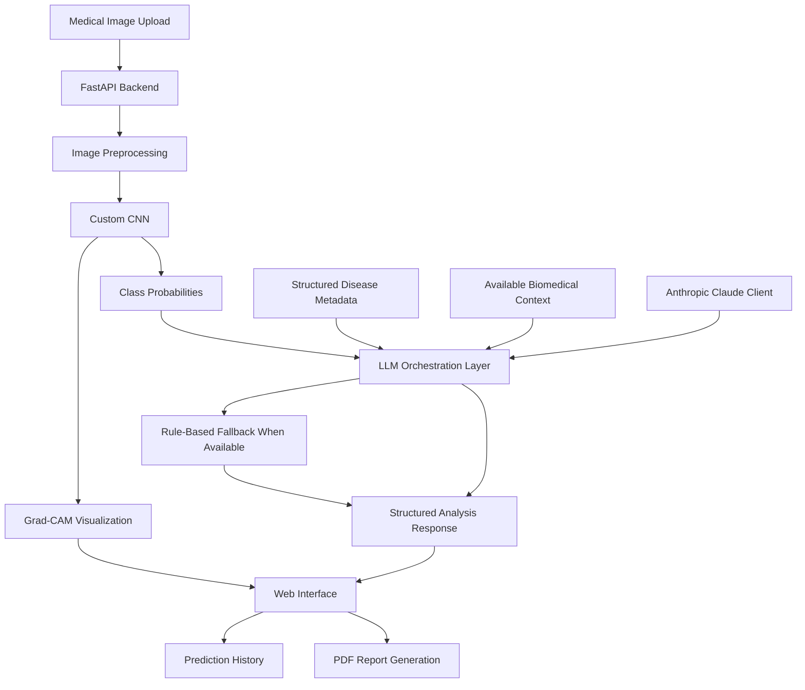

# DeepMed AI — Deep Learning-Based Multi-Disease Detection System

An AI-powered medical image analysis research prototype combining deep learning, explainable AI, and large language model (LLM)-based clinical reasoning in an interactive web application.

**DeepMed AI** integrates a custom Convolutional Neural Network (CNN) for multi-disease image classification with Grad-CAM visualizations, a FastAPI backend, contextual biomedical information, and PDF report generation.

> **Important:** DeepMed AI is an academic research and educational prototype, not a clinically validated medical device. Its outputs are experimental and must not be used as a substitute for professional medical diagnosis or treatment.

---

## Table of Contents

- [Overview](#overview)
- [Key Features](#key-features)
- [System Architecture](#system-architecture)
- [Technology Stack](#technology-stack)
- [Project Structure](#project-structure)
- [Machine Learning Pipeline](#machine-learning-pipeline)
- [Explainable AI](#explainable-ai)
- [LLM-Based Reasoning](#llm-based-reasoning)
- [Installation and Setup](#installation-and-setup)
- [Configuration](#configuration)
- [Running the Application](#running-the-application)
- [API Reference](#api-reference)
- [Model Requirements and Limitations](#model-requirements-and-limitations)
- [Testing](#testing)
- [Troubleshooting](#troubleshooting)
- [Project Contributions](#project-contributions)
- [Future Improvements](#future-improvements)
- [Disclaimer](#disclaimer)

---

## Overview

Medical image analysis involves identifying visual patterns that may be associated with different diseases. DeepMed AI explores how deep learning and language models can be combined to build an integrated medical image analysis workflow.

The application accepts a medical image, processes it through a CNN-based classification pipeline, generates a Grad-CAM visualization where supported, and passes prediction information to a contextual reasoning layer.

The reasoning layer combines structured disease metadata, available biomedical context, and an LLM integration to produce an explanatory output. The application also provides an interactive interface, prediction history, and PDF report generation.

The framework is designed to demonstrate the integration of machine learning models, explainability techniques, backend APIs, and language-model-based reasoning in a single application.

### Project Highlights

- **30 disease classes:** The project is configured for a 30-class classification task.
- **CNN-based classification:** A custom deep learning architecture processes medical images.
- **Explainability:** Grad-CAM generates visual heatmaps intended to illustrate regions influencing model predictions.
- **Contextual reasoning:** An LLM orchestration layer combines predictions with structured disease information and available biomedical context.
- **Web application:** A browser-based interface supports image submission and analysis.
- **PDF reports:** Analysis results can be exported into a report.
- **REST API:** FastAPI exposes endpoints for health checks, analysis, and report generation.

The original project documentation reports **94.82% validation accuracy**. This figure should be interpreted in the context of the original validation setup and does not establish clinical accuracy or generalization to unseen clinical populations.

---

## Key Features

### 1. Multi-Disease Image Classification

- Custom CNN-based image classification.
- Configured for 30 output classes.
- Prediction probabilities and ranked candidate labels, where supported by the implementation.
- Configurable loading of trained model weights.
- Explicit demo-mode behavior when the trained weights are unavailable.

### 2. Explainable AI with Grad-CAM

- Generates heatmaps intended to highlight image regions associated with a model prediction.
- Supports visual comparison of an original image and its heatmap in the web interface.
- Provides explanatory context for interpreting the visualization.

Grad-CAM is a model-interpretability technique. Its heatmaps do not independently prove that a prediction is correct or that a highlighted region represents a medically meaningful finding.

### 3. LLM-Based Clinical Reasoning

- Combines classification output with structured disease metadata.
- Uses contextual information to generate explanatory text.
- Integrates an Anthropic Claude client when configured.
- Provides a rule-based fallback when the LLM is unavailable, as implemented by the application.
- Includes biomedical context adapters with different levels of implementation.

### 4. Interactive Web Application

- Browser-based interface for submitting medical images.
- Patient-context fields supported by the application.
- Prediction history within the current session.
- Visual prediction and explanation display.
- Access to generated PDF reports.

### 5. PDF Report Generation

- Generates downloadable analysis reports.
- Organizes prediction results and explanatory information into a report format.
- Uses ReportLab for PDF generation.

### 6. Backend API

- FastAPI-based backend.
- Image-analysis endpoint.
- Health/status endpoint.
- PDF-report endpoint.
- Interactive API documentation through FastAPI's documentation interface.

---

## System Architecture

DeepMed AI follows a modular architecture that separates image classification, contextual reasoning, API handling, and report generation.



The diagram describes the intended application workflow. The availability of individual model integrations depends on their configuration and implementation status.

### Processing Workflow

1. A user submits a medical image through the web interface.
2. The backend receives the request and invokes the image-analysis pipeline.
3. The CNN produces classification scores when trained weights are loaded successfully.
4. Grad-CAM generates an interpretability visualization when supported by the model and input.
5. The reasoning layer combines prediction information with available metadata and biomedical context.
6. The application returns a structured response to the web interface.
7. The user can review the result and generate a PDF report.

If trained weights are missing, the application may enter demo mode. Demo outputs must not be interpreted as genuine model predictions.

---

## Technology Stack

| Component | Technology |
|---|---|
| Programming language | Python |
| Deep learning | TensorFlow / Keras |
| Image classification | Custom CNN |
| Explainability | Grad-CAM |
| Backend framework | FastAPI |
| API schemas | Pydantic |
| Frontend | HTML, CSS, JavaScript |
| LLM integration | Anthropic API client |
| Biomedical context | Structured metadata and optional BioGPT integration |
| Report generation | ReportLab |
| Dependency management | uv |
| Testing | Python smoke-test scripts |

The exact versions and optional dependencies are defined in `pyproject.toml`.

---

## Project Structure

```text
DeepMed-AI-Multi-Disease-Detection/
│
├── app/
│   ├── __init__.py
│   ├── main.py
│   ├── config.py
│   ├── schemas.py
│   │
│   ├── ml/
│   │   ├── __init__.py
│   │   ├── cnn_model.py
│   │   └── gradcam.py
│   │
│   ├── llm/
│   │   ├── __init__.py
│   │   ├── prompts.py
│   │   ├── claude_client.py
│   │   ├── disease_metadata.py
│   │   ├── biogpt_adapter.py
│   │   ├── medpalm_adapter.py
│   │   └── orchestrator.py
│   │
│   └── report/
│       ├── __init__.py
│       └── pdf_report.py
│
├── frontend/
│   ├── index.html
│   ├── style.css
│   └── app.js
│
├── models/
│   ├── README.md
│   └── best_model.weights.h5
│
├── OUTPUT_SAMPLE_REPORTS/
├── tools/
│   ├── export_class_names_snippet.py
│   └── smoke_test.py
│
├── class_names.json
├── sample_prompt.md
├── SAMPLE_OUTPUTS.md
├── verify_offline.py
├── pyproject.toml
├── .python-version
├── .env.example
├── .gitignore
└── README.md
```

This tree represents the documented repository structure. Optional files, trained weights, and sample reports should be present in the repository before claiming they are included in the published version.

### Important Modules

| File | Responsibility |
|---|---|
| `app/main.py` | FastAPI application and HTTP endpoints |
| `app/config.py` | Environment-based configuration |
| `app/schemas.py` | Request and response models |
| `app/ml/cnn_model.py` | CNN architecture, weight loading, and prediction logic |
| `app/ml/gradcam.py` | Grad-CAM visualization |
| `app/llm/orchestrator.py` | Coordinates contextual reasoning |
| `app/llm/claude_client.py` | Anthropic API integration |
| `app/llm/disease_metadata.py` | Structured disease metadata |
| `app/llm/biogpt_adapter.py` | Biomedical context integration |
| `app/llm/medpalm_adapter.py` | Med-PaLM-related adapter and documented placeholder |
| `app/report/pdf_report.py` | PDF report generation |

---

## Machine Learning Pipeline

The project uses a custom CNN designed for a 30-class medical image classification task.

### Model Input and Output

- **Input:** A medical image processed according to the model's expected input format.
- **Model:** Custom CNN implemented using TensorFlow/Keras.
- **Output:** Classification scores for the configured classes.
- **Interpretability:** Grad-CAM visualization, where supported.
- **Downstream processing:** Classification results are passed to the contextual reasoning layer.

### Model Weights

The documented model-weight path is:

```text
models/best_model.weights.h5
```

The application configuration uses:

```text
CNN_WEIGHTS_PATH=models/best_model.weights.h5
```

The actual weights must match the model architecture used during training. The class-label ordering must also match the original training pipeline.

### Reported Validation Result

| Metric | Reported value |
|---|---:|
| Validation accuracy | 94.82% |
| Number of configured classes | 30 |

These figures are reported in the original project documentation. The evaluation dataset, class distribution, per-class performance, and independent test results should be documented separately before making stronger performance claims.

Validation accuracy alone does not establish clinical usefulness or safety.

---

## Explainable AI

DeepMed AI includes a Grad-CAM module for visualizing image regions associated with CNN predictions.

Grad-CAM uses gradients associated with a target prediction to produce a coarse spatial heatmap. This visualization can help developers inspect model behavior and investigate potential failure cases.

### Intended Benefits

- Visual inspection of model attention.
- Additional context when reviewing predictions.
- Support for debugging and qualitative model evaluation.

### Limitations

- A heatmap is not a medical explanation or proof of causality.
- Highlighted regions may not correspond to medically relevant features.
- Heatmaps do not establish model reliability.
- Clinical interpretation requires independent validation and appropriate expert review.

---

## LLM-Based Reasoning

The application includes an orchestration layer that combines model predictions with contextual information.

### Documented Components

**Structured disease metadata**

Provides disease-related information used by the reasoning layer.

**Anthropic Claude integration**

The Claude client is designed to send requests to Anthropic when a valid API key and compatible configuration are available.

**BioGPT adapter**

The project documentation describes a local BioGPT integration option, with curated biomedical context available as a fallback.

**Med-PaLM adapter**

The current project documentation identifies the Med-PaLM 2 component as a placeholder rather than a fully operational public Med-PaLM 2 integration.

**Rule-based fallback**

The application includes a fallback path intended to produce a structured response when the LLM is unavailable.

### Important Distinction

The presence of an adapter or module does not necessarily mean the corresponding external model is running. Each integration should be verified independently, and its actual status should be reported accurately.

LLM-generated explanations may contain errors or unsupported statements. They must not be treated as verified clinical advice.

---

## Installation and Setup

### Prerequisites

- Git
- Python version compatible with the dependencies in `pyproject.toml`
- uv package manager
- VS Code or another code editor
- An Anthropic API key, if using the Claude integration
- Compatible trained CNN weights for real model inference

TensorFlow compatibility depends on the Python version and operating system. Check package availability before choosing the interpreter.

### Step 1: Clone the Repository

```bash
git clone https://github.com/sharvari-nadig/DeepMed-AI-Multi-Disease-Detection.git
cd DeepMed-AI-Multi-Disease-Detection
```

### Step 2: Install uv

On Windows PowerShell:

```powershell
powershell -ExecutionPolicy ByPass -c "irm https://astral.sh/uv/install.ps1 | iex"
```

On macOS or Linux:

```bash
curl -LsSf https://astral.sh/uv/install.sh | sh
```

Restart the terminal if necessary and verify the installation:

```bash
uv --version
```

### Step 3: Install Dependencies

From the project root:

```bash
uv sync
```

This installs the dependencies defined in `pyproject.toml` and creates a project virtual environment.

If dependency resolution fails because the selected Python version is unsupported by a required package, try a compatible version specified by the project configuration. For example:

```bash
uv sync --python 3.12
```

Use the Python version supported by your dependency set and target operating system.

### Step 4: Configure Environment Variables

Create a local environment file from the example:

```powershell
Copy-Item .env.example .env
```

Open `.env` and configure the values required by the application.

For example:

```dotenv
ANTHROPIC_API_KEY=your_anthropic_api_key
CNN_WEIGHTS_PATH=models/best_model.weights.h5
```

Use the exact variable names supported by `app/config.py` and `.env.example`.

Never commit your real `.env` file or publish API keys.

### Step 5: Verify Model Files

Confirm that the trained weights exist:

```text
models/best_model.weights.h5
```

Verify that `class_names.json` matches the original training label order.

The original documentation notes that the label order was reconstructed and needs confirmation against the training notebook. Until this has been verified, predictions may be assigned incorrect class names even if the model loads successfully.

### Step 6: Start the Application

Run the FastAPI application:

```bash
uv run uvicorn app.main:app --reload --port 8000
```

When the server starts successfully, open:

**Web application:** http://127.0.0.1:8000

**Interactive API documentation:** http://127.0.0.1:8000/docs

To stop the server, press `Ctrl + C` in the terminal.

---

## Configuration

The application uses environment-based configuration.

| Variable | Purpose |
|---|---|
| `ANTHROPIC_API_KEY` | Enables the Anthropic integration when configured correctly |
| `CNN_WEIGHTS_PATH` | Specifies the path to the trained CNN weights |
| `ENABLE_BIOGPT` | Enables the optional BioGPT path, if supported by the implementation |

Consult `.env.example` and `app/config.py` for the complete set of supported configuration variables and their default values.

Do not publish secrets, private credentials, or sensitive patient information.

---

## Running the Application

After starting the server:

1. Open http://127.0.0.1:8000 in a browser.
2. Submit a suitable medical image through the interface.
3. Review the returned prediction and associated visualization, if available.
4. Review the contextual explanation returned by the reasoning layer.
5. Generate a PDF report if the endpoint and report-generation path are functioning correctly.

The precise behavior depends on the configured weights, class-label mapping, optional model integrations, and API configuration.

If the application displays a demo-mode indicator, treat the result as simulated output rather than genuine CNN inference.

---

## API Reference

The project documentation describes the following endpoints.

| Method | Endpoint | Purpose |
|---|---|---|
| `GET` | `/` | Serves the web interface |
| `GET` | `/api/health` | Reports application and model/LLM status |
| `POST` | `/api/analyze` | Accepts an image and supported context fields for analysis |
| `POST` | `/api/report` | Generates a downloadable PDF report from analysis data |

Open http://127.0.0.1:8000/docs after starting the server to inspect the actual request schemas, response formats, and endpoint behavior.

The endpoint descriptions above reflect the existing project documentation. Confirm them against the running application before relying on them.

---

## Model Requirements and Limitations

### Trained Weights

Without compatible trained weights, the application may use demo-mode behavior. Demo outputs must not be presented as genuine classification results.

### Class-Label Mapping

The entries in `class_names.json` must match the precise order used during training. An incorrect mapping can associate model output indices with the wrong labels.

### LLM Availability

The Claude integration requires valid configuration and network access. When unavailable, the application may use its rule-based fallback.

### Biomedical Integrations

The BioGPT path and Med-PaLM-related adapter have different implementation statuses. Do not assume that all documented models are actively running.

### Clinical Reliability

The reported validation accuracy is not a substitute for independent testing, external validation, calibration assessment, or clinical evaluation.

---

## Testing

The repository contains scripts for offline checks and broader pipeline testing.

### Offline Verification

Run:

```bash
uv run python verify_offline.py
```

The original documentation describes this script as a dependency-light verification of components such as metadata, prompts, adapters, orchestration fallback, demo prediction logic, Grad-CAM helpers, and PDF generation.

Review the actual test output to determine which checks pass.

### Full Pipeline Smoke Test

Run:

```bash
uv run python tools/smoke_test.py
```

This test is documented as checking real model inference, Grad-CAM, and the live Claude integration. It requires compatible trained weights and appropriate API configuration.

To test using specified images:

```bash
uv run python tools/smoke_test.py image1.png image2.png
```

Use actual image paths that are compatible with the model's expected input format.

Do not report tests as passing until you have run them and reviewed their results.

---

## Troubleshooting

### The application starts in demo mode

Check that the configured model-weight file exists and that `CNN_WEIGHTS_PATH` points to the correct location.

### Predictions show incorrect disease labels

Verify the exact class-label ordering against the original training pipeline and regenerate `class_names.json` if necessary.

### The Claude integration is unavailable

Check the API key, environment-variable name, network connectivity, and API configuration. Never place a real API key in the source code or README.

### Dependency installation fails

Check your Python version, operating system, and package compatibility. Consult `pyproject.toml` and the package installation documentation.

### The model weights fail to load

Verify that the architecture defined in `app/ml/cnn_model.py` is compatible with the architecture used to generate the weights.

### The smoke test fails

Review the full traceback and identify whether the issue concerns dependencies, missing model files, class labels, API configuration, or image preprocessing.

---

## Project Contributions

DeepMed AI was developed collaboratively as an academic group project.

My contributions included participating in the development and integration of the medical AI application, working with deep learning-based disease classification, and exploring the integration of explainable AI and LLM-based reasoning.

The project brings together a CNN-based image classification pipeline, Grad-CAM visualizations, a FastAPI backend, contextual reasoning components, and PDF report generation.


---

## Future Improvements

- Verify the class-label mapping against the original training pipeline.
- Evaluate the model on an independent test dataset.
- Report per-class precision, recall, F1-score, and confusion matrices.
- Assess model calibration, robustness, and failure cases.
- Expand automated testing for model inference and API behavior.
- Improve configuration validation and error handling.
- Test and document each optional LLM integration independently.
- Add reproducible deployment instructions.
- Strengthen privacy safeguards for patient-related inputs.
- Conduct appropriate external and clinical validation before considering real-world clinical use.

---

## Disclaimer

DeepMed AI is intended for academic research, software engineering, and educational experimentation.

It is not a clinically validated medical device and must not be used to diagnose, treat, or manage medical conditions. Predictions, visualizations, and generated explanations may be inaccurate or misleading.

Always consult qualified healthcare professionals for medical decisions. Do not upload identifiable patient information to third-party services unless the necessary authorization, privacy safeguards, and legal requirements have been addressed.

---

## Acknowledgements

DeepMed AI originated as a collaborative academic group project. The project incorporates contributions from team members and may use third-party libraries, models, and other resources. Applicable licenses, copyright notices, and attribution requirements are retained.
